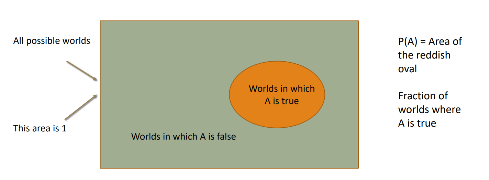
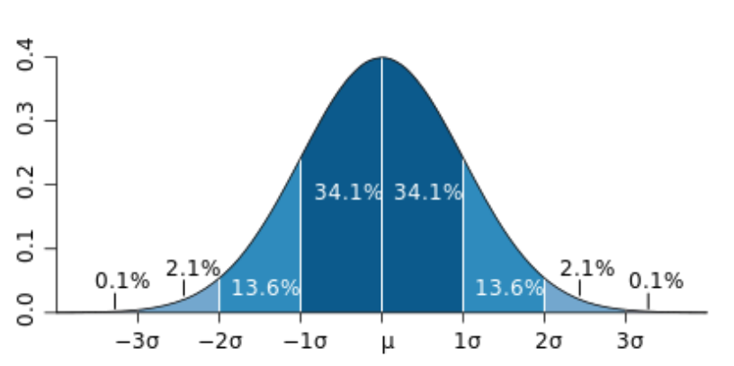

# HY577 - Μηχανική Μάθηση
## Κεφάλαιο 1ο: Probabilities

### Kolmogorov Axioms
The basic ideas is that a probability is like a area of a square which has total area equal to 1. Every point on the square is a possible outcome and an event A is a region. $P(A)$ is the area of that region. 

Every axiom then just says something otherwise "obvious" about that area.

There are 4 main rules for axioms:
1. $0 \leq P(A) \leq 1$:

    A region cannot have a negative area and can't be bigger then the whole square

2. $P(\empty) = 0$:

    The empty region is the event "nothing happens", this has no area as in no world it's true.

3. $P(S) = 1$:

    The probability that any of the possible outcomes happens is always 1. 

4. $P(A~\cup~B) = P(A) + P(B) - P(A~\cap~B)$:

    To ge the area covered by A or B we add both areas and the subtract the overlap as otherwise it's counted twice.

### Bayesian Interpretation
The Bayesian interpration of probability basically states that if e.g $P(A) = 0.3$ this means: "*I believe $A$ with strength $0.3$*".

So probability is a **degree of belief** held by someone given their knowledge.

More particularly Bayesian has 3 claims:
1. *You can believe anything*:

    You are free to choose the prior $P(A)$, two people can start with completely different numbers.

2. *You believs must obey the axioms*:

    The rules earlier stated for the axioms have to be obeyed.

3. *You must update your believs correctly with new evidence*:

    When new data arrives we have to revise our belief.

### Variables
**Random Variables**: a function that maps each outcome of an experiment to a value.

E.g A dice roll with a sample space $S =\{1,2,3,4,5,6\}$, we can define lots of variables such as:

|Variable|Rule|Domain D(V)|
|-|-|-|
|$X$|the face itself|$\{1,...,6\}$|
|$V$|the face squared|$\{1,4,9,...,36\}$
|$E$|1 if even, 0 if odd|$\{0,1\}$|

The experiment is the same each time, the variables are just different questions about it's outcome.

There are some specific types of variables:
- **Continuous**: The domain is a set of real numbers
- **Discrete**: The domain is a countable set (e.g integers)
- **Categorical**: The domain is a finite set of valeus (e.g {Cristian, Jews, Muslims})
    - Nominal: a categorical variable with no ordering of the values
    - Ordinal: a categorical where values are ordered
    - Boolean: taking two values

### Probability Distribution
Lets assume $X$ is the outcome of a dice so $D(X)=\{1,2,3,4,5,6\}$. 
- $P(3)$ is a **number**, e.g 1/6
- $P(X)$ is a **function** of how likely it is that X takes each value from its set.

A continuous random variable can take any value in an interval of the real line, this variable might be length, time, possition, etc. It's hence not possible to talk about the probability of the random variable assuming a particullar value:

$$ 
P(X=x) = 0 
$$ 

Instead we define the probability of the random variable taking a value within a given interval or half interval:
- $P(X \in [x_1 : x_2])$
- $P( X \leq x) = P(X \in (-\infty, x])$

That probability of the random variable assuming a value withing the given range is actually the area under the Probability Distribution funcion for that area. So it is calculated with the integral:

$$
P(X \in [x_1:x_2]) = \int^{x_1}_{x_2} p(x)dx
$$

#### Probability Density function
The probability density function (PDF) $p(x)$ is a curve whose area gives probability. It has two requirements:
1. $p \geq 0$ everywhere
2. The total area is 1 $\int^{+\infty}_{-\infty} p(x)dx = 1$

$p(x)$ can also be greater then 1 as it's the **probability per unit of $x$**, in the same way density in physics is mass per units volume.

### Gausian distribution
$$
p(x) = \frac{1}{\sigma \sqrt{2\pi}} e^{-\frac{-(x-\mu)^2}{2\sigma^2}}
$$
The distribution is summetric and is often illustrated as a bell-shaped curve. It has two parameters:
1. mean ($\mu$): the center of the "bell"
2. standart deviation ($\sigma$): the width of the curve

For any gaussian:
|Interval|Probability|
|-|-|
|$\mu = \pm 1 \sigma$ | $\approx 68 \%$ |
|$\mu = \pm 2 \sigma$ | $\approx 95 \%$ |
|$\mu = \pm 3 \sigma$ | $\approx 99.7 \%$ |

### Joint Distribution
A joint distribution gives the probability of combinations of values of several random variables at once:

$$
P(X=x, Y=y) \quad \text{for every pair } (x,y) 
$$

It answers the question: "*How likekly is each combination of the $X$ and $Y$*"

### Conditional Probability
$P(A \mid B)$ is the probability of $A$ given that $B$ is true. Knowing $B$ shrinks the sample space: every outcome where $B$ is false is ruled out.

$$
P(A \mid B) = \frac{P(A \cap B)}{P(B)} = \frac{P(A, B)}{P(B)}, \quad P(B) > 0
$$

**Chain rule:**

$$
\begin{aligned}
P(A, B) &= P(A \mid B)\,P(B) = P(B \mid A)\,P(A) \\
P(A, B, C, D) &= P(A \mid B, C, D)\,P(B \mid C, D)\,P(C \mid D)\,P(D)
\end{aligned}
$$

### Bayes Rule

$$
P(B \mid A) = \frac{P(A \mid B)\,P(B)}{P(A)} = \frac{P(A \mid B)\,P(B)}{\sum_k P(A \mid B = k)\,P(B = k)}
$$

### Unconditional Independence
We say that two events $A$ and $B$ are **independent** if $P(A,B) = P(A) \times P(B)$

